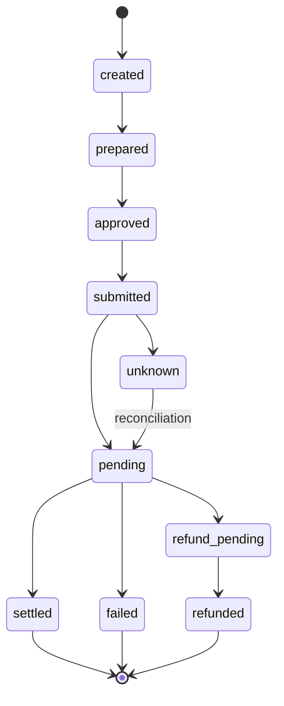

# Operation lifecycle

Model every financial action as a durable operation. Browser retries and worker
restarts must converge on the same external action instead of creating another one.

## Meaning of states

Prepared means a valid plan exists. Approved means the user accepted the bound
plan. Submitted means a request was sent; it does not mean funds arrived. Unknown
means submission may have happened but confirmation was lost. Failed requires a
verified failure, not merely a timeout. Refund pending is distinct from refunded.

## Idempotency

Scope a caller's key to subject, tenant, environment and operation kind. Bind it
to a canonical request digest. Reusing the same key with different input must fail.
Create the operation and reservation atomically before submitting a provider request.
Reuse provider correlation IDs on supported retries.

## Reconciliation

After an ambiguous result, look up the existing provider operation or chain
transaction. Do not generate a new transfer or quote while the original remains
unresolved. Apply terminal transitions once using an atomic state guard; duplicate
events may be acknowledged without posting another credit.

An operation can require several external legs. Track each leg and recovery action
separately; a completed source transfer does not prove destination settlement.
See [jobs](jobs.md), [webhooks](webhooks.md) and
[cross-chain swaps](../swaps/cross-chain.md).
