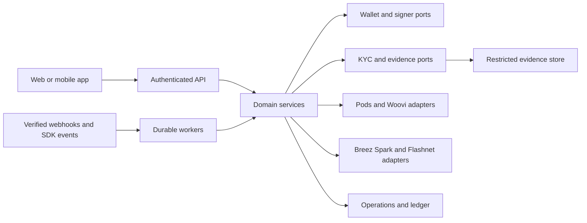

# Architecture

Use a small application core with replaceable adapters. The core owns subjects,
wallet references, KYC decisions, operation state and ledger entries. Providers
own external accounts and confirmations; signers own key access.

## Request path

Authenticate, resolve the subject, check tenant/environment and capability, validate
the request, then create a durable operation. Return an operation reference instead
of waiting indefinitely for a provider. A worker prepares or submits the external
step and reconciles its outcome. The UI reads normalized operation state.

## Data separation

Identity documents and biometric evidence belong in a restricted store. The domain
keeps opaque references and approval states. A provider's response is validated
and projected into this model, never serialized wholesale into domain records or
browser responses.

Wallet custody is a deliberate architecture choice. A provider-neutral signer
contract permits client signing, embedded wallets or an independently reviewed
server custody solution. It does not make those models equivalent.

## Suggested implementation

Start with login and mock adapters. Add operation persistence and ledger invariants
before adding live rails. Introduce Pods for ramps/swaps, Woovi for Pix/BaaS and
Bitcoin adapters independently. Follow [boundaries](boundaries.md),
[domain model](domain-model.md), [jobs](jobs.md) and
[provider contracts](../providers/contracts.md).
